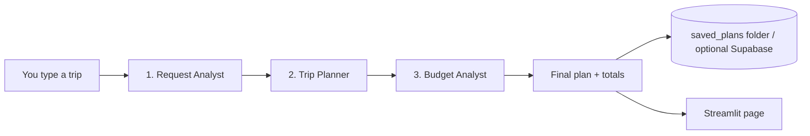

# ✈️ AI Travel Planner

Type a trip in plain English, for example:

> *Plan a 5 day trip to Goa for 2 people from Pune with a moderate budget. We love food and beaches.*

and get a complete, readable plan: destination overview, flight and hotel **estimates**, local transport,
a day-by-day itinerary, a budget table and money-saving tips. You can download the plan as Markdown or JSON.

Built with **Google Gemini** (the AI), **LangGraph** (the step-by-step workflow), **Streamlit** (the web page)
and, optionally, **Supabase** (saving plans online).

---

## What it does (and what it does not)

| ✅ Does | ❌ Does not |
|---|---|
| Understands a free-text trip request | Show live flight or hotel prices |
| Plans destination, stays, transport, daily itinerary | Book anything |
| Builds a budget and checks it against your budget | Browse travel websites |
| Saves every plan in the `saved_plans` folder | Guarantee that a place is open or available |

All prices are **AI estimates**. Always verify flights, hotels and visa/entry rules before booking.

## How it works



Each of the 3 steps is **one call to Gemini** that must answer in a strict structure (so the page never has to
guess). The totals, per-person cost and "over/under budget" are calculated by normal code, not by the AI.
If the chosen Gemini model runs out of its free daily quota, the next model is tried automatically.

## Project layout

```
app.py                  The web page (Streamlit)
check_setup.py          Run this when something does not work. It tells you why.
run_app.bat             Double-click to start the app (Windows)
travel_planner/
    config.py           Reads your .env file
    models.py           The data shapes (request, plan, budget...)
    prompts.py          The instructions given to Gemini
    llm.py              Talks to Gemini; handles quota, retries, bad keys, errors
    graph.py            The LangGraph workflow (3 steps + final assembly)
    render.py           Turns a plan into Markdown
    storage.py          Saves plans (local folder, optional Supabase)
    usage.py            Daily trip counter that protects your free quota when public
    prices.py           Live flight/hotel prices from Google via SerpApi (optional)
    sharing.py          Share links stored in Supabase (optional)
tests/                  Automatic tests (they use a fake Gemini; no internet needed)
legacy/                 The old unfinished prototype, kept for reference only
.env                    YOUR secrets (you create this; never uploaded to GitHub)
```

## Setup on Windows (one time)

Open **Command Prompt** (press the Windows key, type `cmd`, press Enter), then:

```bat
cd /d "C:\path\to\openai-agents-travel-graph"
python -m venv .venv
.venv\Scripts\activate
python -m pip install --upgrade pip
pip install -r requirements.txt
copy .env.example .env
notepad .env
```

In Notepad, paste your key after `GEMINI_API_KEY=` (no quotes, no spaces), save, close. Get a free key at
<https://aistudio.google.com/apikey> (keys starting with `AQ.` are the new normal format).

Check everything works:

```bat
python check_setup.py
```

## Run it

```bat
cd /d "C:\path\to\openai-agents-travel-graph"
.venv\Scripts\activate
streamlit run app.py
```

(or just double-click `run_app.bat`). Your browser opens at <http://localhost:8501>. Press `Ctrl + C` in the
black window to stop it.

## Run the automatic tests

```bat
pip install -r requirements-dev.txt
python -m pytest -q
```

## Free-tier limits (important)

The free Gemini tier only allows a limited number of requests per day, and the limits change over time (see the
rate-limit page in Google AI Studio for your exact numbers). One trip plan uses **3 requests**.
Flash-Lite models normally have a far bigger free allowance than the larger Flash models, so
`gemini-3.5-flash-lite` is the default. You can change the model in the sidebar or with `GEMINI_MODEL` in `.env`.

## Troubleshooting

| Message | What to do |
|---|---|
| "No Gemini API key was found" | `.env` is missing or `GEMINI_API_KEY=` is empty. |
| "Google rejected the API key" | Create a new key at AI Studio and paste it again (no quotes). Then run `pip install -U google-genai`. |
| "free Gemini quota is used up" | Wait for the daily reset, enable billing, or pick another model. |
| "servers are busy" | Wait a minute and try again. |
| Anything else | Run `python check_setup.py` and read the message. |

## Optional: save plans to Supabase

1. In Supabase open **SQL Editor**, paste the contents of `supabase_schema.sql`, click **Run**.
2. `pip install supabase`
3. In `.env` set `SAVE_TO_SUPABASE=true`, `SUPABASE_URL=...`, `SUPABASE_KEY=...`.

The table is locked down (Row Level Security), so it needs the secret **service_role** key. Keep that key only in
your local `.env`, never share it, and never put it in a public place.

## Share it online (free): Streamlit Community Cloud

This app is a Streamlit app, which needs a server that stays running. **Vercel cannot host it** (Vercel runs
short-lived serverless functions, not long-running servers). Streamlit's own free hosting is the right fit and
works straight from your GitHub repository.

1. Push the project to GitHub (see "Push to GitHub" in the chat guide, or `git add -A`, `git commit`, `git push`).
2. Go to <https://share.streamlit.io> and sign in with GitHub.
3. Click **Create app**, choose **"Yup, I have an app"**, then pick your repository, branch `master`,
   and main file path `app.py`.
4. Click **Advanced settings**. Choose Python 3.12, then paste into **Secrets** (use your own real key):

   ```toml
   GEMINI_API_KEY = "paste-your-key-here"
   GEMINI_MODEL = "gemini-3.5-flash-lite"
   PUBLIC_MODE = "true"
   DAILY_TRIP_LIMIT = "40"
   SESSION_TRIP_LIMIT = "5"
   ```
5. Click **Deploy**. After a few minutes you get a link like `https://something.streamlit.app` to share.

Good to know:
- **Your key is never in GitHub.** It lives only in the Secrets box (and your local `.env`, which git ignores).
- `PUBLIC_MODE` makes the site store nothing and hide "Saved trips", so visitors cannot see each other's plans.
- The daily/per-visit limits protect your free Gemini quota from being used up by strangers. Keep billing off
  on your Google AI Studio project unless you want to pay for heavy use.
- Free apps may go to sleep when nobody visits and wake up when someone opens the link.
- To change a setting later: app menu, **Settings**, **Secrets**.

## Real flight and hotel prices (optional)

The AI normally gives *estimates*. With a SerpApi key the app also looks up **live prices from Google Flights and
Google Hotels** and uses them in the budget. (Amadeus closed its free developer API in July 2026, so SerpApi is the
practical choice.)

1. Create a free account at <https://serpapi.com/users/sign_up?plan=free> and copy your API key from
   <https://serpapi.com/manage-api-key>. Check their pricing page for the current free allowance (reported as
   about 250 searches per month) and terms.
2. Local use: add `SERPAPI_API_KEY=your_key` to `.env`.
   Online: add `SERPAPI_API_KEY = "your_key"` to the app's **Secrets**.
3. Restart the app. A checkbox "Include live flight & hotel prices" appears under *Optional details*.

How it works and what to know:
- One trip uses **2 searches** (flights + hotels). Repeated identical trips are cached for 1 hour and cost nothing.
- Flights need a **"Travelling from"** city. Without it only hotels are looked up.
- If you give no travel dates, example dates 30 days ahead are used and the page says so clearly.
- Hotel prices are for a standard room for 2 guests; the budget multiplies by the rooms you need.
- In public mode the app allows **4 live-price lookups per day** (`LIVE_PRICES_DAILY_LIMIT`) to protect your allowance.
  After that, plans still work using AI estimates.
- If a lookup fails for any reason, the plan still appears with AI estimates and a short notice.
- Live prices come from Google and can change quickly. Always confirm on the booking site.

## Share links (optional)

"Create a shareable link" stores the finished plan in your Supabase project and gives a link like
`https://your-app.streamlit.app/?plan=<long random id>`. Anyone with the link can view that plan. WhatsApp and email
buttons for a short summary always work, with no setup.

1. In Supabase: resume the project if it is paused, open **SQL Editor**, paste `supabase_schema.sql`, click **Run**.
2. In **Project Settings, API Keys** create a **secret key** (starts with `sb_secret_`).
3. Add to the app's **Secrets** (or `.env` locally):
   ```toml
   ENABLE_SHARING = "true"
   SUPABASE_URL = "https://YOUR-PROJECT.supabase.co"
   SUPABASE_KEY = "sb_secret_..."
   APP_URL = "https://your-app.streamlit.app"
   ```
4. Restart the app.

Good to know: free Supabase projects **pause after about a week without activity**, and share links will not open
until you resume the project in the Supabase dashboard. The secret key lives only in your Secrets, never in GitHub.
Each visitor can create up to 5 links per visit (`SHARE_SESSION_LIMIT`).

## Ideas for the future

- Booking links with your affiliate id
- Google Search grounding so the AI can check current events and opening hours
- Login + a "my trips" page, deploy to Streamlit Community Cloud

## License

MIT - see `LICENSE`.
